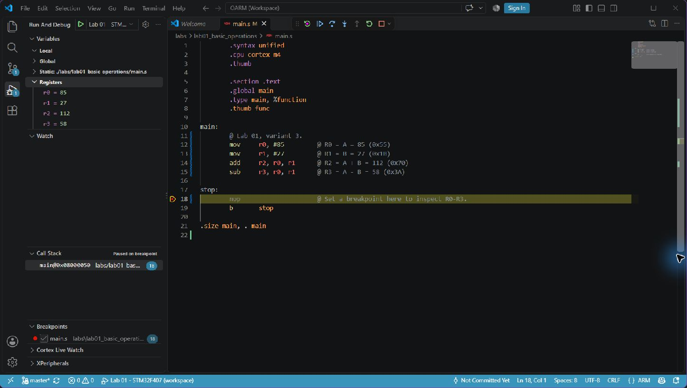

# Practical Work 1 — Number Systems and First ARM Assembly Instructions

Work in `labs/lab01_basic_operations/` on branch `lab01` in your personal
course fork. Before starting, follow the
[student workflow](../../docs/student-workflow.md) to set up instructor review.
Build from the repository root using
`make PROJECT=labs/lab01_basic_operations`, then follow the course debugging
instructions.

## Topic

**Binary, decimal, hexadecimal numbers and first ARM Assembly instructions: `MOV`, `ADD`, `SUB`.**

## Goal

After this practical work, you should be able to:

- convert numbers between decimal, binary, and hexadecimal manually;
- write simple ARM Assembly code using `MOV`, `ADD`, and `SUB`;
- load values into ARM registers;
- check register values in Cortex-Debug;
- perform addition and subtraction manually in column form and compare the result with the debugger.

---

## Important Rules

1. Do the number conversions **manually**.
2. Show your work.
3. Do not use online converters for the main task.
4. Use the debugger only to **check** your result.
5. All numbers in this practical work are **unsigned**.
6. For binary column calculations, use at least **8 bits**.

---

## Short Reminder

### Decimal to binary

Example:

```text
42₁₀ = 32 + 8 + 2 = 101010₂
```

### Binary to decimal

Example:

```text
101010₂ = 1×32 + 0×16 + 1×8 + 0×4 + 1×2 + 0×1 = 42₁₀
```

### Decimal to hexadecimal

Example:

```text
42₁₀ = 2A₁₆
```

### Hexadecimal to decimal

Example:

```text
2A₁₆ = 2×16 + 10 = 42₁₀
```

---

## ARM Assembly Examples

### Example 1 — `MOV`

```asm
        .syntax unified
        .cpu cortex-m4
        .thumb
        .global main

        .text

main:
        mov     r0, #42        @ R0 = 42
        mov     r1, #5         @ R1 = 5

stop:
        nop
        b       stop
```

Check in Cortex-Debug:

```text
R0 = 42
R1 = 5
```

---

### Example 2 — `ADD` and `SUB`

```asm
        .syntax unified
        .cpu cortex-m4
        .thumb
        .global main

        .text

main:
        mov     r0, #10        @ R0 = 10
        mov     r1, #3         @ R1 = 3

        add     r2, r0, r1     @ R2 = R0 + R1 = 13
        sub     r3, r0, r1     @ R3 = R0 - R1 = 7

stop:
        nop
        b       stop
```

Check in Cortex-Debug:

```text
R0 = 10
R1 = 3
R2 = 13
R3 = 7
```

---

## What You Must Submit

For your variant, submit:

1. Manual conversions.
2. Manual addition and subtraction in column form.
3. Your ARM Assembly source code.
4. A screenshot from Cortex-Debug showing the register values.
5. A short conclusion: whether your manual results match the register values.

Place your code in `main.s`. Append a **Student report** section to this
`README.md` with your name, GitHub username, variant number, manual work,
completed register table, and conclusion. Keep the original tasks and variant
tables. Create `screenshots/` inside this lab directory, save your register
screenshot as `screenshots/debug_registers.png`, and reference it in your report.

Submit a PR from `lab01` to `master` **in your own fork**, following the
[student workflow](../../docs/student-workflow.md). Send the instructor the PR
URL; if a classroom platform or LMS is used, submit that same URL there.
Address feedback on the same branch and merge only after `@ant112342` approves
the current work. A push or merge alone does not count as lab acceptance.

Do not commit `build/` or generated `.o`, `.elf`, `.bin`, or `.map` files.

---

# Task 1 — Manual Number Conversion

For your variant, convert all numbers to the required number systems.

For each decimal number, write:

```text
N₁₀ = ______₂ = ______₁₆
```

For each binary number, write:

```text
N₂ = ______₁₀ = ______₁₆
```

For each hexadecimal number, write:

```text
N₁₆ = ______₁₀ = ______₂
```

---

## Variants

### Variant 1

| Task | Number |
|---|---|
| Decimal numbers | 42₁₀, 63₁₀ |
| Binary numbers | 101010₂, 11110000₂ |
| Hexadecimal numbers | 2A₁₆, A5₁₆ |
| Assembly values | A = 42, B = 15 |

### Variant 2

| Task | Number |
|---|---|
| Decimal numbers | 14₁₀, 52₁₀ |
| Binary numbers | 1110₂, 100100₂ |
| Hexadecimal numbers | 0E₁₆, 7C₁₆ |
| Assembly values | A = 52, B = 18 |

### Variant 3

| Task | Number |
|---|---|
| Decimal numbers | 85₁₀, 127₁₀ |
| Binary numbers | 01010101₂, 01111111₂ |
| Hexadecimal numbers | 55₁₆, 3B₁₆ |
| Assembly values | A = 85, B = 27 |

### Variant 4

| Task | Number |
|---|---|
| Decimal numbers | 100₁₀, 229₁₀ |
| Binary numbers | 01100100₂, 11100101₂ |
| Hexadecimal numbers | 64₁₆, E5₁₆ |
| Assembly values | A = 100, B = 37 |

### Variant 5

| Task | Number |
|---|---|
| Decimal numbers | 36₁₀, 215₁₀ |
| Binary numbers | 00100100₂, 11010111₂ |
| Hexadecimal numbers | 24₁₆, D7₁₆ |
| Assembly values | A = 96, B = 28 |

### Variant 6

| Task | Number |
|---|---|
| Decimal numbers | 78₁₀, 165₁₀ |
| Binary numbers | 01001110₂, 10100101₂ |
| Hexadecimal numbers | 4E₁₆, A5₁₆ |
| Assembly values | A = 78, B = 23 |

### Variant 7

| Task | Number |
|---|---|
| Decimal numbers | 240₁₀, 255₁₀ |
| Binary numbers | 11110000₂, 11111111₂ |
| Hexadecimal numbers | F0₁₆, FF₁₆ |
| Assembly values | A = 120, B = 45 |

---

# Task 2 — Manual Addition and Subtraction

Use your assembly values:

```text
A = ______
B = ______
```

Calculate manually:

```text
A + B = ______
A - B = ______
```

Show both operations in column form.

## Decimal column form

```text
     A
+    B
------
   A+B
```

```text
     A
-    B
------
   A-B
```

## Binary column form

Use at least 8 bits.

Example:

```text
  00101010
+ 00001111
----------
  00111001
```

```text
  00101010
- 00001111
----------
  00011011
```

## Hexadecimal column form

Example:

```text
  2A
+ 0F
----
  39
```

```text
  2A
- 0F
----
  1B
```

---

# Task 3 — ARM Assembly Program

Write an ARM Assembly program for your variant.

Use:

```text
R0 = A
R1 = B
R2 = A + B
R3 = A - B
```

Use this template:

```asm
        .syntax unified
        .cpu cortex-m4
        .thumb
        .global main

        .text

main:
        mov     r0, #A         @ R0 = A
        mov     r1, #B         @ R1 = B

        add     r2, r0, r1     @ R2 = A + B
        sub     r3, r0, r1     @ R3 = A - B

stop:
        nop
        b       stop
```

Replace `A` and `B` with the numbers from your variant.

Example:

```asm
        mov     r0, #42
        mov     r1, #15

        add     r2, r0, r1
        sub     r3, r0, r1
```

---

# Task 4 — Debugging

Run your program and check the registers in Cortex-Debug.

Fill in the table:

| Register | Meaning | Expected value | Debugger value |
|---|---|---:|---:|
| R0 | A |  |  |
| R1 | B |  |  |
| R2 | A + B |  |  |
| R3 | A - B |  |  |

---

# Task 5 — Short Conclusion

Write 2–3 sentences.

Example:

```text
The values in registers R0 and R1 match the input numbers from my variant.
The values in R2 and R3 match my manual addition and subtraction results.
Therefore, the ARM Assembly program works correctly.
```

---

## Optional Question

What happens if `A - B` becomes negative in unsigned arithmetic?

Write your answer in 1–2 sentences.

---

## Student report

- **ПІБ:** Головчук Юліан Володимирович
- **GitHub:** ButaFor
- **Варіант:** 3
- **Плата:** GlobalLogic GL-SK-BSP, STM32F407VGT6

### 1. Переведення чисел між системами числення

#### Десяткові числа 85 і 127

Послідовне ділення на 2; остачі читаються знизу вгору:

```text
85 : 2 = 42, остача 1       127 : 2 = 63, остача 1
42 : 2 = 21, остача 0        63 : 2 = 31, остача 1
21 : 2 = 10, остача 1        31 : 2 = 15, остача 1
10 : 2 =  5, остача 0        15 : 2 =  7, остача 1
 5 : 2 =  2, остача 1         7 : 2 =  3, остача 1
 2 : 2 =  1, остача 0         3 : 2 =  1, остача 1
 1 : 2 =  0, остача 1         1 : 2 =  0, остача 1
```

Для 8-бітного запису додаємо початковий нуль. Переведення у шістнадцяткову систему:

```text
 85 : 16 = 5, остача 5  → 55₁₆
127 : 16 = 7, остача 15 → 7F₁₆, де F = 15

85₁₀  = 01010101₂ = 55₁₆
127₁₀ = 01111111₂ = 7F₁₆
```

#### Двійкові числа 01010101 і 01111111

Розкладаємо числа за степенями двійки:

```text
01010101₂ = 0×128 + 1×64 + 0×32 + 1×16 + 0×8 + 1×4 + 0×2 + 1×1
          = 64 + 16 + 4 + 1 = 85₁₀

01111111₂ = 0×128 + 1×64 + 1×32 + 1×16 + 1×8 + 1×4 + 1×2 + 1×1
          = 64 + 32 + 16 + 8 + 4 + 2 + 1 = 127₁₀
```

Для переведення у шістнадцяткову систему групуємо біти по чотири:

```text
0101 0101₂ → 5 5₁₆ → 55₁₆
0111 1111₂ → 7 F₁₆ → 7F₁₆

01010101₂ = 85₁₀  = 55₁₆
01111111₂ = 127₁₀ = 7F₁₆
```

#### Шістнадцяткові числа 55 і 3B

```text
55₁₆ = 5×16 + 5 = 80 + 5 = 85₁₀
3B₁₆ = 3×16 + 11 = 48 + 11 = 59₁₀, де B = 11

5₁₆ = 0101₂, 3₁₆ = 0011₂, B₁₆ = 1011₂

55₁₆ = 85₁₀ = 01010101₂
3B₁₆ = 59₁₀ = 00111011₂
```

### 2. Додавання та віднімання стовпчиком

Вхідні значення:

```text
A = 85₁₀ = 01010101₂ = 55₁₆
B = 27₁₀ = 00011011₂ = 1B₁₆
27 = 16 + 8 + 2 + 1 = 1×16 + 11
```

#### Десяткова система

```text
   85          85
+  27       -  27
-----       -----
  112          58
```

Додавання: 5 + 7 = 12, записуємо 2 і переносимо 1; 8 + 2 + 1 = 11.
Віднімання: позичаємо десяток, 15 − 7 = 8; 7 − 2 = 5.

#### Двійкова система (8 біт)

```text
  01010101       01010101
+ 00011011     - 00011011
----------     ----------
  01110000       00111010
```

Обчислення виконуємо справа наліво: під час додавання 1 + 1 дає 0 з переносом 1, а під час віднімання 0 − 1 позичаємо одиницю зі старшого розряду.
Перевірка: 01110000₂ = 64 + 32 + 16 = 112₁₀; 00111010₂ = 32 + 16 + 8 + 2 = 58₁₀.

#### Шістнадцяткова система

```text
  55          55
+ 1B        - 1B
----        ----
  70          3A
```

Додавання: 5 + B = 5 + 11 = 16₁₀ = 10₁₆, записуємо 0 і переносимо 1; 5 + 1 + 1 = 7.
Віднімання: позичаємо 16, (16 + 5) − 11 = 10 = A₁₆; у старшому розряді 4 − 1 = 3.

```text
A + B = 112₁₀ = 01110000₂ = 70₁₆
A − B =  58₁₀ = 00111010₂ = 3A₁₆
```

### 3. Програма ARM Assembly

Код міститься в [main.s](main.s). Інструкції `MOV` записують A і B у R0 та R1, `ADD` обчислює суму в R2, а `SUB` — різницю в R3. Після обчислень програма переходить у цикл `stop`.

### 4. Перевірка на STM32F407

Програму зібрано, завантажено у Flash і виконано на платі через ST-Link та Cortex-Debug. Значення зчитано після виконання `SUB`, на точці зупинки перед `nop` у рядку 18.

| Регістр | Значення | Очікується, DEC | Cortex-Debug, DEC | HEX |
|---|---|---:|---:|---|
| R0 | A | 85 | 85 | 0x55 |
| R1 | B | 27 | 27 | 0x1B |
| R2 | A + B | 112 | 112 | 0x70 |
| R3 | A − B | 58 | 58 | 0x3A |



### 5. Висновок

Виконано переведення чисел варіанта 3 між десятковою, двійковою та шістнадцятковою системами числення, а також додавання й віднімання стовпчиком. Значення R0 = 85, R1 = 27, R2 = 112 і R3 = 58, отримані на STM32F407, збігаються з розрахунками. Отже, програма з інструкціями `MOV`, `ADD` і `SUB` працює правильно.

### Додаткове запитання

Якщо A < B, результат беззнакового віднімання у 32-бітному регістрі обчислюється за модулем 2³²: наприклад, 0 − 1 дає 4294967295 (0xFFFFFFFF). У варіанті 3 A > B, тому такого переходу через нуль немає.
